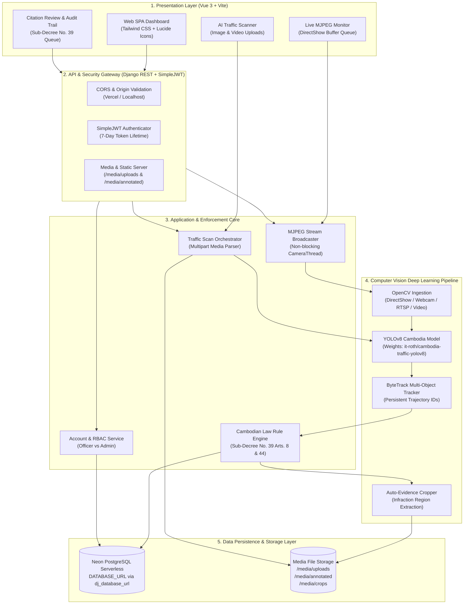

# BIU Traffic AI (`biu-traffic-ai`)
### BELTEI International University • AI-Powered Traffic Law Enforcement System

[](https://biu-traffic-ai.vercel.app)
[](https://biu-traffic-api.onrender.com)
[](https://huggingface.co/it-roth/cambodia-traffic-yolov8)
[](https://github.com/it-roth/biu-traffic-ai)

---

## 📌 Executive Overview

**BIU Traffic AI** (`biu-traffic-ai`) is an enterprise-grade intelligent surveillance and automated law enforcement platform developed at **BELTEI International University (BIU)**. The platform combines cutting-edge deep learning (**YOLOv8** + **ByteTrack**) with Cambodian traffic law enforcement engines (**Royal Government Sub-Decree No. 39 Articles 8 & 44**), delivering real-time vehicle telemetry, helmet compliance auditing, passenger overload detection, and high-resolution evidence archiving for police officers and university campus checkpoints.

* **Live Frontend:** [https://biu-traffic-ai.vercel.app](https://biu-traffic-ai.vercel.app)
* **Live API Backend:** [https://biu-traffic-api.onrender.com](https://biu-traffic-api.onrender.com)
* **Official Hugging Face Model:** [https://huggingface.co/it-roth/cambodia-traffic-yolov8](https://huggingface.co/it-roth/cambodia-traffic-yolov8)
* **Database:** Neon Serverless PostgreSQL (SSL-pooled)

---

## 🏛️ System Architecture & Engineering Blueprint

### 1. Architectural Dataflow



---

## ⚖️ Cambodian Traffic Law Engine (Sub-Decree No. 39)

The AI engine automatically cross-references vision detections with Cambodia's **Sub-Decree No. 39 on Road Traffic Fines**:

| Infraction Type | Legal Basis | Standard Fine (KHR) | Approx. USD | System Action |
| :--- | :--- | :---: | :---: | :--- |
| **No Helmet** | Sub-Decree No. 39 • Article 8 | **60,000 KHR** | ~\$15 | Red HUD bounding box, auto-crops evidence snapshot |
| **Passenger Overload** | Sub-Decree No. 39 • Article 44 | **100,000 KHR** | ~\$25 | Flagged when riders $> 2$ on motorcycle |
| **Dual Infraction** | Articles 8 & 44 Combined | **160,000 KHR** | ~\$40 | Dual citation penalty, high-priority police flag |
| **Compliant Passage** | Law Compliant | **0 KHR** | \$0 | Green HUD bounding box, logged as compliant |

---

## 🤖 Hugging Face Model Hub Integration

The fine-tuned model weights are open-sourced on Hugging Face:
👉 **[huggingface.co/it-roth/cambodia-traffic-yolov8](https://huggingface.co/it-roth/cambodia-traffic-yolov8)**

### Quick Start with Python & Ultralytics

You can run the model directly from the Hugging Face Hub in 3 lines:

```bash
pip install ultralytics
```

```python
from ultralytics import YOLO

# 1. Load weights directly from Hugging Face
model = YOLO('https://huggingface.co/it-roth/cambodia-traffic-yolov8/resolve/main/best.pt')

# 2. Run inference on traffic photo or video stream
results = model.predict(source='phnom_penh_traffic.jpg', conf=0.35)

# 3. Display detection with bounding boxes and classes
results[0].show()
```

---

## 📊 Dataset & Model Benchmarks

### Cambodian Road Traffic Dataset
* **Dataset Domain:** Phnom Penh metropolitan traffic corridors (Monivong Blvd, Russian Blvd, Norodom Blvd, Kampuchea Krom).
* **Target Classes (8 specialized classes):**
  1. `rider_with_helmet` — Compliant motorcyclist
  2. `rider_no_helmet` — Sub-Decree 39 Article 8 violation
  3. `motorcycle` — Standard two-wheeled motorbikes
  4. `auto_rickshaw` — Three-wheeled PassApp / Bajaj autorickshaws
  5. `remorque` — Traditional Khmer motorcycle-trailer tuk-tuks
  6. `car` — Passenger automobiles, sedans, SUVs
  7. `truck` — Heavy commercial logistics vehicles
  8. `bus` — City transit and regional passenger buses

### Evaluation Metrics
| Metric | Score | Note |
| :--- | :---: | :--- |
| **`rider_no_helmet` mAP@50** | **99.5%** | Specialized helmet infraction accuracy |
| **Model Size** | **6.23 MB** | Optimized YOLOv8 Nano architecture |
| **Inference Latency** | **24 ms** | Real-time 30+ FPS capable on standard CPU |
| **Tracking Pipeline** | **ByteTrack** | Persistent trajectory association & ID retention |

---

## 🚀 Cloud Deployment Architecture

The project runs on a decoupled serverless cloud infrastructure:

```
[ Frontend: Vercel Global CDN ] ──HTTPS──> [ Backend API: Render Docker Container ]
                                                  │
                                                  ├──> [ AI Model: YOLOv8 (best.pt) ]
                                                  └──> [ DB: Neon PostgreSQL Serverless ]
```

### 1. Backend (Render Docker Web Service)
* **Image:** `python:3.10-slim` with OpenCV & CPU PyTorch.
* **Web Server:** Gunicorn with 2 workers and 120s timeout.
* **Auto Migration:** Automatically seeds database superusers (`admin` / `admin123`) and runs migrations on start.
* **Static & Media:** WhiteNoise for static assets; `django.views.static.serve` for evidence photos.

### 2. Frontend (Vercel)
* **Framework:** Vue 3.5 + Vite + Tailwind CSS.
* **Environment:** `VITE_API_URL=https://biu-traffic-api.onrender.com/api/`.
* **API Proxy:** Configured via `vercel.json` rewrites.

---

## 💻 Local Development Setup

### 1. Backend (Django REST Framework)

```bash
cd backend

# Create and activate virtual environment
python -m venv venv
.\venv\Scripts\activate       # Windows
source venv/bin/activate      # Linux/macOS

# Install dependencies
pip install -r requirements.txt

# Run migrations and launch local server
python manage.py migrate
python manage.py runserver 0.0.0.0:8000
```

### 2. Frontend (Vue 3 + Vite)

```bash
cd frontend

# Install npm packages
npm install

# Start Vite development server
npm run dev
```

Open **[http://localhost:5173](http://localhost:5173)** in your browser.

---

## 📡 REST API Reference

| Endpoint | Method | Description |
| :--- | :---: | :--- |
| `/api/auth/login/` | `POST` | Authenticate officer and receive 7-day JWT tokens |
| `/api/auth/token/refresh/` | `POST` | Refresh expired JWT access token |
| `/api/auth/protected/` | `GET` | Retrieve logged-in officer profile & permissions |
| `/api/scan/image/` | `POST` | Process photo for YOLOv8 detection & auto-crop violations |
| `/api/scan/video/` | `POST` | Run ByteTrack tracking on video (.mp4) and log unique infractions |
| `/api/traffic/stream/` | `GET` | Live multipart MJPEG video stream with real-time HUD |
| `/api/traffic/stream/stop/`| `POST`| Instantly release webcam/hardware device |
| `/api/traffic/stats/` | `GET` | Aggregated telemetry (vehicles, compliance rate, fines) |
| `/api/violations/` | `GET` | Paginated enforcement records with evidence URLs |

---

## 👥 Project Team & Academic Credits

### Final Capstone Project — BELTEI International University (BIU)
* **Faculty:** Information Technology & Science
* **Department:** Computer Science & Software Engineering
* **Academic Year:** 2025 – 2026
* **Campus:** Campus 10, Phnom Penh, Kingdom of Cambodia

| No. | Student Name | Student ID | Role & Core Responsibilities |
| :---: | :--- | :---: | :--- |
| **01** | **Leng Saroth** | `00057189` | **Team Lead & Computer Vision Engineer**<br>• Custom YOLOv8 model training, hyperparameter tuning & Hugging Face deployment<br>• Cambodian traffic dataset curation & ByteTrack multi-object tracking pipeline |
| **02** | **Tin Narong** | `00057374` | **Full-Stack Backend Engineer**<br>• Django 6.1 REST Framework, SimpleJWT auth & Neon Serverless PostgreSQL DB<br>• Real-time MJPEG video stream controller & Sub-Decree No. 39 legal citation engine |
| **03** | **Sem Sela** | `00058037` | **Frontend Engineer & UI/UX Designer**<br>• Vue 3.5, Vite & Tailwind CSS responsive dashboard command center<br>• Real-time HUD surveillance feed & bilingual Khmer/English localization |
| **04** | **Von Vathana** | `00055778` | **Frontend & QA Engineer**<br>• UI components, audit history log view & cross-browser responsiveness<br>• Integration testing, evidence preview lightbox & user experience optimization |
| **05** | **Heng TangLy** | `00057704` | **DevOps & System Integration**<br>• Docker containerization, Vercel & Render production deployment orchestration<br>• End-to-end telemetry verification, API documentation & evidence archiving |

### 🎓 Academic Supervision
* **Project Advisor:** **Dr. Chen Sovann**
* **Institution:** **BELTEI International University** • Phnom Penh, Kingdom of Cambodia

---

### 📄 License & Intellectual Property
Distributed under the **MIT License**. Developed for academic evaluation and public traffic law enforcement research under Cambodian road safety standards.

© 2026 BELTEI International University • Cambodia Traffic Law Enforcement System. All rights reserved.
